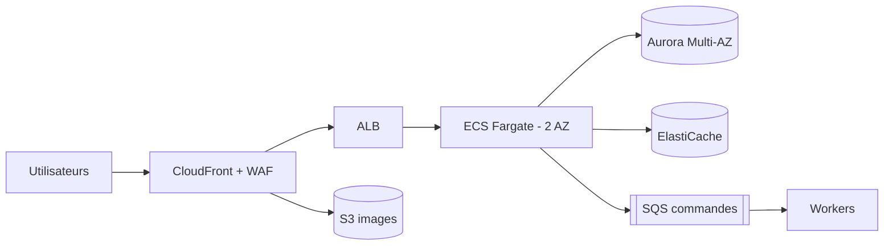

# Labo 14 — Étude de cas « ShopFlow »

## Contexte
ShopFlow est un site e-commerce français : 200 000 visiteurs/jour, pics ×5 pendant les soldes (2 fois/an), catalogue de 50 000 produits avec images, paiement via un prestataire externe, comptes clients (RGPD).

## Exigences
| Domaine | Exigence |
|---|---|
| Disponibilité | 99,95 % |
| DR | RTO 1 h, RPO 5 min |
| Sécurité | Données personnelles en UE, chiffrement, audit |
| Performance | Page produit < 1 s au p95 en France |
| Budget | 6 000 €/mois (hors soldes) |
| Équipe | 4 DevOps, déploiements quotidiens sans interruption |

## Livrables
1. **Architecture** (diagramme + justification). Modèle Mermaid :

2. **Stratégie DR** : choix (Pilot Light ? Warm Standby ?), réplication, procédure de bascule, plan de test trimestriel.
3. **Coût** : estimation Pricing Calculator (lien) + 5 leviers chiffrés.
4. **Well-Architected** : 3 risques/pilier + atténuations.
5. **Soutenance** : 10 min + 5 min de questions.

## Grille d'évaluation (100 pts)
| Critère | Pts |
|---|---|
| Adéquation aux exigences (dispo, DR, perf) | 25 |
| Sécurité et conformité | 20 |
| Pertinence et justification des services | 15 |
| Estimation de coût réaliste + optimisation | 20 |
| Exploitabilité (CI/CD, observabilité, IaC) | 10 |
| Clarté de la présentation | 10 |

## Éléments de correction (pistes)
- Frontal : CloudFront (cache images/pages) + WAF ; images S3 + OAC.
- Calcul : ECS Fargate sur 2-3 AZ, autoscaling par requêtes, Fargate Spot pour workers.
- Données : Aurora PostgreSQL Multi-AZ + réplica inter-région (Aurora Global, RPO ~1 s) ; ElastiCache pour sessions/catalogue ; S3 CRR pour images.
- DR : **Warm Standby** en seconde région d'UE (Irlande/Francfort) ; bascule Route 53 ; tests via FIS.
- Coûts : Savings Plans sur la charge de base, Graviton, S3 Intelligent-Tiering, endpoints pour éviter la NAT, scale-down hors heures.
- Pics (soldes) : pré-échauffement, scheduled scaling, cache agressif, file d'attente pour le paiement.
