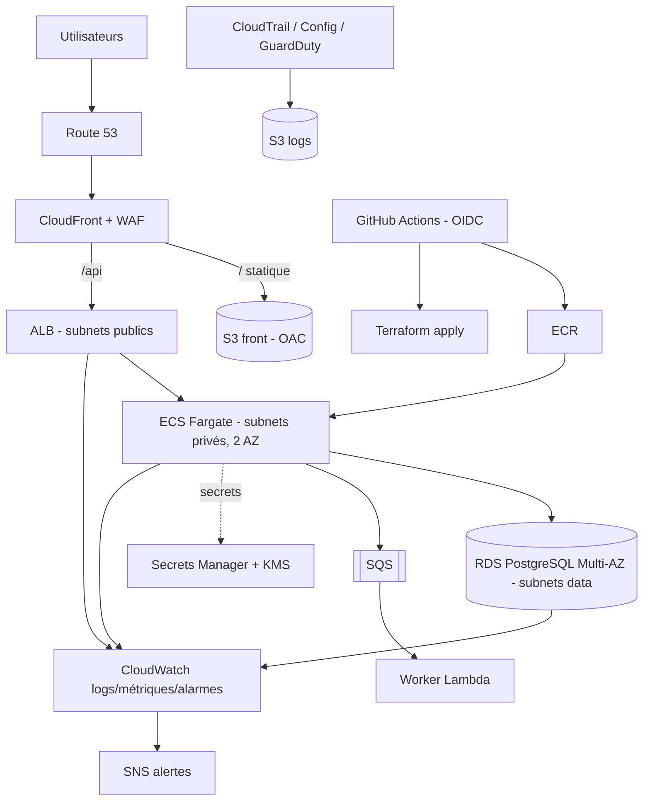

# Module 16 — Projet final : plateforme cloud complète

**Durée** : 3 jours (individuel ou binôme) · **Niveau** : expert · **Coût** : prévoir 5–15 € si détruit chaque soir
**Rôle** : évaluation de fin de parcours, et pièce de portfolio.

## 1. Le sujet

Vous êtes l'ingénieur DevOps de **« TaskHub »**, application de gestion de tâches. Livrez une plateforme **de production** qui héberge l'API et son interface, entièrement **as code**, déployée par **pipeline**, observable, sécurisée, et chiffrée en coût.

### Architecture cible

## 2. Exigences fonctionnelles et techniques

### Obligatoires (60 pts)
| # | Exigence |
|---|---|
| 1 | **Réseau** : VPC 2 AZ, subnets public/privé/data, aucun accès Internet entrant direct vers app et BD, endpoints S3 (et ECR si NAT absente) |
| 2 | **Compute** : API conteneurisée sur ECS Fargate (≥ 2 tâches, 2 AZ), image dans ECR (tags = SHA, scan activé) |
| 3 | **Données** : RDS PostgreSQL chiffré, Multi-AZ, sauvegardes, secret géré (Secrets Manager) |
| 4 | **Edge** : CloudFront + S3 privé (OAC) pour le front ; route `/api/*` vers l'ALB ; HTTPS |
| 5 | **IaC** : 100 % Terraform (modules + backend S3 distant), `fmt/validate/tflint/checkov` verts |
| 6 | **CI/CD** : GitHub Actions + OIDC (aucune clé), build → test → scan → push ECR → déploiement ECS avec rollback automatique ; plan Terraform sur PR |
| 7 | **Observabilité** : dashboard, alarmes 5xx/latence/CPU/BD, logs avec rétention, SNS vers e-mail |
| 8 | **Sécurité** : moindre privilège (rôles dédiés), WAF managé, IMDSv2, pas de secret en clair, chiffrement KMS |
| 9 | **Coûts** : tags obligatoires, budget, estimation mensuelle documentée |
| 10 | **Documentation** : README, diagramme, runbook d'exploitation, ADR (décisions d'architecture) |

### Bonus (jusqu'à 25 pts)
- Blue/Green avec CodeDeploy, ou canary (+5)
- Multi-environnements dev/prod avec comptes séparés (Organizations) (+5)
- Autoscaling par requêtes + test de charge documenté (+4)
- DR : réplica inter-région + procédure testée (+5)
- Traçage X-Ray/OpenTelemetry (+3)
- Tests d'infra Terratest / `terraform test` (+3)

## 3. Planning conseillé

| Jour | Objectifs | Résultat attendu |
|---|---|---|
| **J1 – Fondations** | Backend d'état, réseau, ECR, RDS, secrets | `terraform apply` sur l'infra de base |
| **J2 – Application & pipeline** | ECS + ALB, CloudFront/S3, OIDC, workflow CI/CD | Une modification du code se déploie automatiquement |
| **J3 – Production-ready** | Observabilité, WAF, sécurité, rollback, coût, doc, démo | Soutenance |

Un squelette de démarrage est fourni dans [`starter/`](starter/) (structure de dossiers, `Makefile`, ADR modèle, check-list).

## 4. Livrables

1. Dépôt Git (code, pipelines, doc).
2. `ARCHITECTURE.md` (schéma + décisions + alternatives écartées).
3. `RUNBOOK.md` : déploiement, rollback, incident « 5xx en hausse », restauration de BD, rotation de secret.
4. `COSTS.md` : estimation mensuelle, 5 optimisations.
5. **Démo live de 15 min** : push de code → pipeline → déploiement ; panne simulée (tuer une tâche, forcer le failover RDS) ; alerte reçue ; revue de sécurité (Security Hub / checkov).

## 5. Grille d'évaluation (100 pts + bonus)

| Domaine | Pts | Critères |
|---|---|---|
| Architecture & réseau | 15 | Isolation correcte, multi-AZ, justification |
| IaC | 15 | Modularité, state distant, lisibilité, absence de duplication |
| CI/CD | 15 | OIDC, étapes, scans, rollback, promotion d'artefact |
| Sécurité | 15 | Moindre privilège, chiffrement, secrets, WAF, durcissement |
| Observabilité & exploitation | 10 | Alarmes pertinentes, runbook, logs exploitables |
| Fiabilité | 10 | Résistance démontrée aux pannes |
| Coûts | 5 | Tags, estimation, optimisations |
| Documentation & soutenance | 15 | Clarté, ADR, démonstration |

Seuils : < 50 à retravailler · 50-69 acquis · 70-84 solide · ≥ 85 **expert**.

## 6. Pièges à éviter

- Commencer par l'application plutôt que par les fondations (réseau, état, pipeline).
- Tout mettre dans un seul état Terraform géant (découper : `network`, `data`, `app`).
- Utiliser des clés d'accès « temporairement » (elles restent).
- Oublier `terraform destroy` entre deux sessions (💰 NAT, ALB, RDS Multi-AZ).
- Ne pas tester les restaurations.

## 7. Auto-évaluation finale

Cochez uniquement ce que vous savez faire **sans aide** :

- [ ] Concevoir un VPC multi-AZ et expliquer chaque route
- [ ] Écrire une policy IAM au moindre privilège avec conditions
- [ ] Déployer ECS/Fargate derrière ALB avec autoscaling et rollback
- [ ] Industrialiser avec Terraform (modules, backend, CI) et diagnostiquer une dérive
- [ ] Construire un pipeline OIDC sans clé
- [ ] Définir alarmes, dashboards et SLO utiles
- [ ] Chiffrer avec KMS et gérer des secrets avec rotation
- [ ] Dimensionner un DR selon RTO/RPO
- [ ] Gouverner un parc de comptes avec SCP
- [ ] Optimiser les coûts d'une architecture existante
